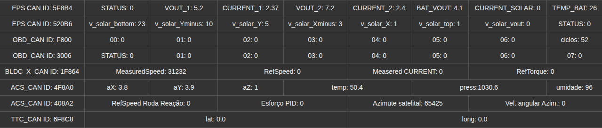

# CubeSat · Dashboard de telemetria LoRa

Dashboard em Python que lê o receptor LoRa pela porta serial e mostra, em tempo
real, dois painéis lado a lado:

- **Velocidades da roda de reação** (esquerda): gráfico dos últimos 60 s de
  MeasuredSpeed, RefSpeed (`1F864`) e Esforço PID (`408A2`), eixo fixo de -3000
  a +3000. A legenda mostra o valor mais recente de cada série.
- **Atitude** (direita): relógio para acompanhar o posicionamento angular do
  CubeSat, com os dados do `408A2`:
  - ponteiro **vermelho, curto** = Setpoint_atitude (ângulo pedido, devolvido
    pelo satélite depois do comando LIGA ATITUDE);
  - ponteiro **branco, longo** = posição atual (Azimute satélite);
  - mostrador de 30° em 30°, 360° no alto, sentido horário;
  - legenda: setpoint, posição atual (0 a 359°), velocidade angular (°/s, com
    sinal) e diferença até o alvo pelo caminho mais curto (-180 a +180°);
  - ângulo fora de 0–359 aparece como "inválido (N)" e não move o ponteiro;
  - sem `408A2` por mais de 5 s: "sem dados há X s" e ponteiros em cinza.

Cada painel tem um botão **Limpar**.

## Requisitos

- Python 3.10+ com tkinter (já vem no instalador do Windows; no Ubuntu: `sudo apt install python3-tk`)
- `pyserial`: `pip install -r requirements.txt`
- Receptor LoRa ligado por USB (adaptador FTDI FT231X), 115200 baud

## Uso

```bash
python3 dashboard.py
```

A porta do receptor é detectada sozinha (procura o adaptador FTDI; se não achar,
usa a primeira porta USB). Se o receptor estiver desconectado, o programa espera
e conecta quando ele for plugado.

Opções:

```
--port COM5          força a porta (ex.: COM5 no Windows, /dev/ttyUSB0 no Linux)
--baud 115200        velocidade da serial
--janela 60          segundos mostrados nos gráficos
--tela-cheia         janela do tamanho da tela (usado no Raspberry, tela 800x480)
--tcp HOST:PORTA     recebe as linhas do Node-RED em vez de abrir a serial
```

No Raspberry o dashboard roda com `--tcp localhost:5555`: lá o Node-RED é quem
abre a serial do LoRa (para também enviar comandos ao CubeSat) e repassa cada
linha recebida ao dashboard por essa porta.

No Linux, o usuário precisa estar no grupo `dialout` para abrir a serial.

## Executável para Windows

O executável precisa ser gerado **no próprio Windows** (o PyInstaller não gera
`.exe` a partir do Linux).

1. Instale o Python 3 em <https://www.python.org/downloads/>, marcando
   **"Add python.exe to PATH"**.
2. Baixe este repositório (botão **Code → Download ZIP**) e extraia.
3. Dê dois cliques em **`build_windows.bat`**.

O script instala o PyInstaller e o pyserial, gera `CubeSatDashboard.exe` e copia
para a Área de Trabalho. Depois disso o Python não é mais necessário: basta clicar
no ícone.

Observações:
- O driver do FTDI normalmente é instalado pelo Windows Update. Se o receptor não
  aparecer, instale o driver **VCP** do site da FTDI.
- O Windows Defender às vezes desconfia de executáveis do PyInstaller. Se bloquear:
  **Mais informações → Executar assim mesmo**.
- O `build_windows.bat` ainda não foi testado num Windows.

## Formato das mensagens

O receptor envia uma mensagem CAN por linha:

```
{0001F864:FF86000000000000}
```

(8 dígitos hex de ID, `:`, 8 bytes de dados). O formato antigo com espaços,
`{0001F864 FF 86 00 00 00 00 00 00}`, também é aceito. Linhas com menos ou mais
de 8 bytes são descartadas.

Decodificação usada (nomes dos campos conforme `mapaCAN2.png`):

| ID | Campos | Formato |
|---|---|---|
| `1F864` | MeasuredSpeed, RefSpeed, Measured Current, RefTorque | 4 × int16 big-endian com sinal |
| `408A2` | Setpoint_atitude, Esforço PID, Azimute satélite, Vel. angular Azim. | 4 × 16 bits big-endian: Setpoint_atitude e Azimute sem sinal (0–359°); Esforço PID e Vel. angular (°/s) com sinal |
| `520B6` | v_solar_bottom, Yminus, Y, Xminus, X, top, vout, STATUS | 8 × uint8 |



## Como mudar os gráficos

Tudo fica na lista `CHARTS`, no topo de `dashboard.py`: título, faixa do eixo
(`y=(mínimo, máximo, passo)`), se os valores são com sinal, e as séries
(`(can_id, campo, rótulo, cor)`). Novos IDs entram em `DECODERS`, em `can_parser.py`.

## Testes

```bash
python3 -m unittest
```

## Problemas conhecidos

- **Dados misturados entre IDs (firmware).** Parte dos quadros `1F864`, `520B6`,
  `5F8B4` e `F800` chega com bytes de outros IDs (ex.: `86FF050301020000` = início
  do `1F864` + fim do `520B6`), além de quadros preenchidos pela metade. Isso gera
  os picos nos gráficos. A causa provável é um buffer compartilhado no firmware
  que monta os pacotes LoRa; a correção é um buffer por ID ou copiar ID + 8 bytes
  de forma atômica. `408A2` e `4F8A0` chegam limpos.
- **Ordem dos bytes**: `1F864` é lido como int16 big-endian com sinal. Com o firmware antigo o `1F864` chegava em little-endian (roda parada:
  `7A00` → +122); se aparecerem valores como 31232 com a roda parada, a ordem
  voltou a ser little-endian.
