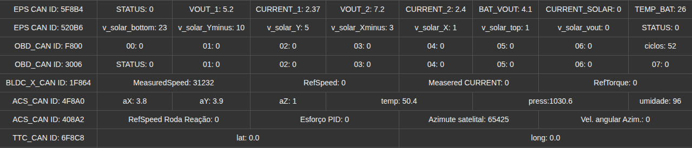

# CubeSat · Dashboard de telemetria LoRa

Dashboard em Python que lê o receptor LoRa pela porta serial e mostra, em tempo
real, dois gráficos lado a lado:

| Gráfico | Séries | Eixo Y |
|---|---|---|
| **Velocidades da roda de reação** (esquerda) | MeasuredSpeed, RefSpeed (`1F864`) · RefSpeed Roda Reação, Esforço PID (`408A2`) | fixo, -2000 a +2000 (int16 com sinal) |
| **Painéis solares e atitude** (direita) | v_solar_bottom, Yminus, Y, Xminus, X, top, vout (`520B6`, sem STATUS) · Azimute satélite, Vel. angular Azim. (`408A2`) | fixo, 0 a 400 |

Cada gráfico mostra os últimos 60 s e tem um botão **Limpar**. A legenda mostra o
valor mais recente de cada série.

## Requisitos

- Python 3.10+ com tkinter (já vem no instalador do Windows; no Ubuntu: `sudo apt install python3-tk`)
- `pyserial`: `pip install -r requirements.txt`
- Receptor LoRa ligado por USB (adaptador FTDI FT231X), 9600 baud

## Uso

```bash
python3 dashboard.py
```

A porta do receptor é detectada sozinha (procura o adaptador FTDI; se não achar,
usa a primeira porta USB). Se o receptor estiver desconectado, o programa espera
e conecta quando ele for plugado.

Opções:

```
--port COM5          força a porta (ex.: COM5 no Windows, /dev/ttyUSB0 no Linux)
--baud 9600          velocidade da serial
--janela 60          segundos mostrados nos gráficos
```

No Linux, o usuário precisa estar no grupo `dialout` para abrir a serial.

## Executável para Windows

O executável precisa ser gerado **no próprio Windows** (o PyInstaller não gera
`.exe` a partir do Linux).

1. Instale o Python 3 em <https://www.python.org/downloads/>, marcando
   **"Add python.exe to PATH"**.
2. Baixe este repositório (botão **Code → Download ZIP**) e extraia.
3. Dê dois cliques em **`build_windows.bat`**.

O script instala o PyInstaller e o pyserial, gera `CubeSatDashboard.exe` e copia
para a Área de Trabalho. Depois disso o Python não é mais necessário: basta clicar
no ícone.

Observações:
- O driver do FTDI normalmente é instalado pelo Windows Update. Se o receptor não
  aparecer, instale o driver **VCP** do site da FTDI.
- O Windows Defender às vezes desconfia de executáveis do PyInstaller. Se bloquear:
  **Mais informações → Executar assim mesmo**.
- O `build_windows.bat` ainda não foi testado num Windows.

## Formato das mensagens

O receptor envia uma mensagem CAN por linha:

```
{0001F864:86FF000000000000}
```

(8 dígitos hex de ID, `:`, 8 bytes de dados). O formato antigo com espaços,
`{0001F864 86 FF 00 00 00 00 00 00}`, também é aceito. Linhas com menos ou mais
de 8 bytes são descartadas.

Decodificação usada (nomes dos campos conforme `mapaCAN2.png`):

| ID | Campos | Formato |
|---|---|---|
| `1F864` | MeasuredSpeed, RefSpeed, Measured Current, RefTorque | 4 × int16 **little-endian** com sinal |
| `408A2` | RefSpeed Roda Reação, Esforço PID, Azimute satélite, Vel. angular Azim. | 4 × uint16 big-endian (no gráfico da esquerda convertidos para int16 com sinal) |
| `520B6` | v_solar_bottom, Yminus, Y, Xminus, X, top, vout, STATUS | 8 × uint8 |



## Como mudar os gráficos

Tudo fica na lista `CHARTS`, no topo de `dashboard.py`: título, faixa do eixo
(`y=(mínimo, máximo, passo)`), se os valores são com sinal, e as séries
(`(can_id, campo, rótulo, cor)`). Novos IDs entram em `DECODERS`, em `can_parser.py`.

## Testes

```bash
python3 -m unittest
```

## Problemas conhecidos

- **Dados misturados entre IDs (firmware).** Parte dos quadros `1F864`, `520B6`,
  `5F8B4` e `F800` chega com bytes de outros IDs (ex.: `86FF050301020000` = início
  do `1F864` + fim do `520B6`), além de quadros preenchidos pela metade. Isso gera
  os picos nos gráficos. A causa provável é um buffer compartilhado no firmware
  que monta os pacotes LoRa; a correção é um buffer por ID ou copiar ID + 8 bytes
  de forma atômica. `408A2` e `4F8A0` chegam limpos.
- **Ordem dos bytes ainda não confirmada** para os campos que até agora só vieram
  zerados (RefSpeed, Measured Current, RefTorque, Esforço PID, Vel. angular). O
  little-endian do `1F864` foi confirmado só com o MeasuredSpeed (roda parada:
  `7A00` → +122, `86FF` → -122). O codec do Node-RED lê `1F864` em big-endian, por
  isso mostrava 31232.
- **Sinal do Azimute e da Vel. angular**: tratados como sem sinal (0 a 400). Se
  forem com sinal, valores negativos aparecem como ~65000 (presos no topo).
- **Serial perto do limite**: ~9000 de 9600 bit/s. Se o tráfego aumentar, convém
  subir a velocidade do receptor e usar `--baud`.
